# Paper figures

The figures below are rendered from the paper's original figure files. The source hashes and paper identity are recorded in [figures.json](figures.json). Model logos retain their [MIT notice](assets/model-logos-LICENSE.txt).

## Figure 1

Task coverage and representative deliverables.

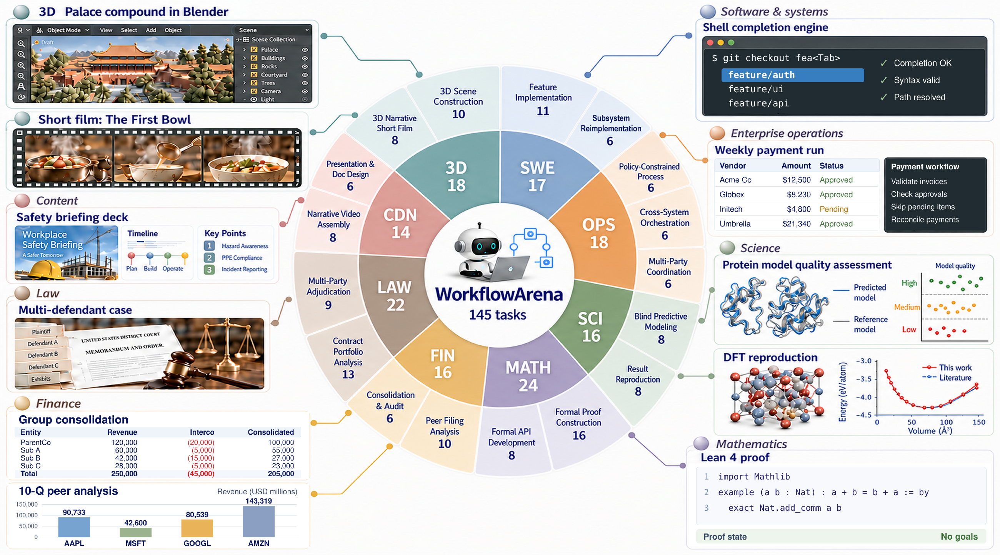

## Figure 2

Benchmark construction and evaluation protocol.

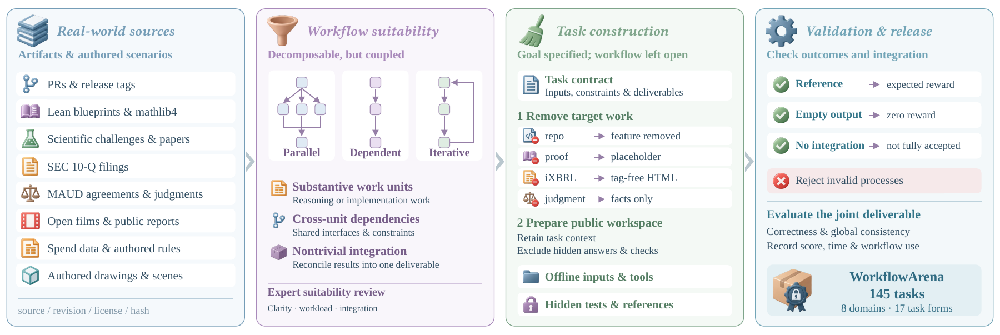

## Figure 3

Resolved rate versus mean tokens per task; input, output and cached input include main agents and workers.

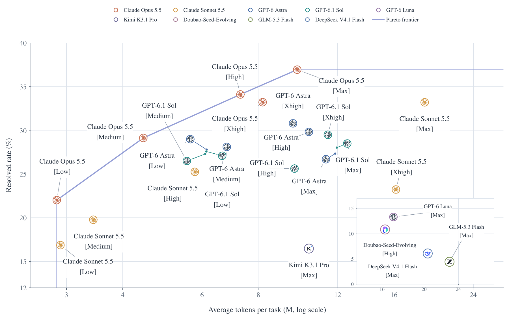

## Figure 4

Resolved rate versus estimated mean inference cost per task, using the paper's pricing snapshot.

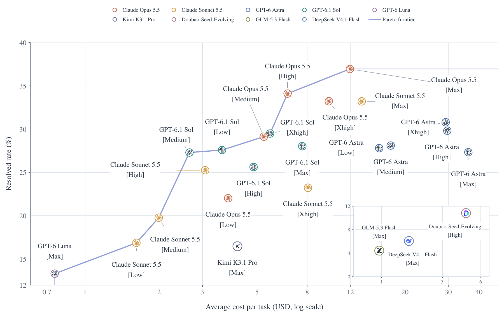

## Figure 5

Workflow invocation frequency and worker invocations per Workflow at high effort.

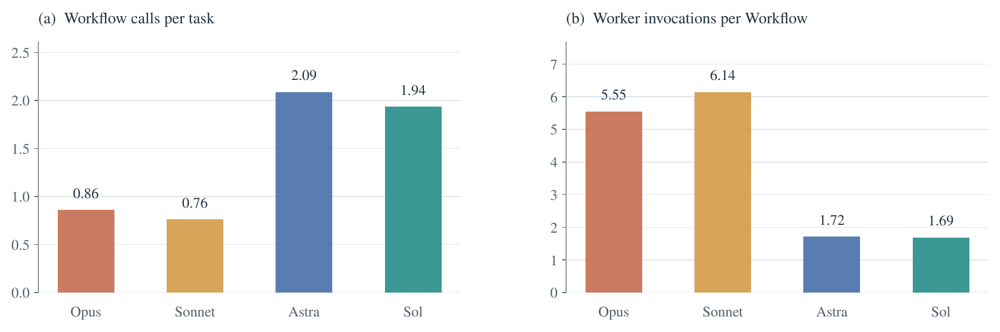

## Figure 6

Delegation frequency and size distributions, conditioned on nonempty tasks and Workflows.

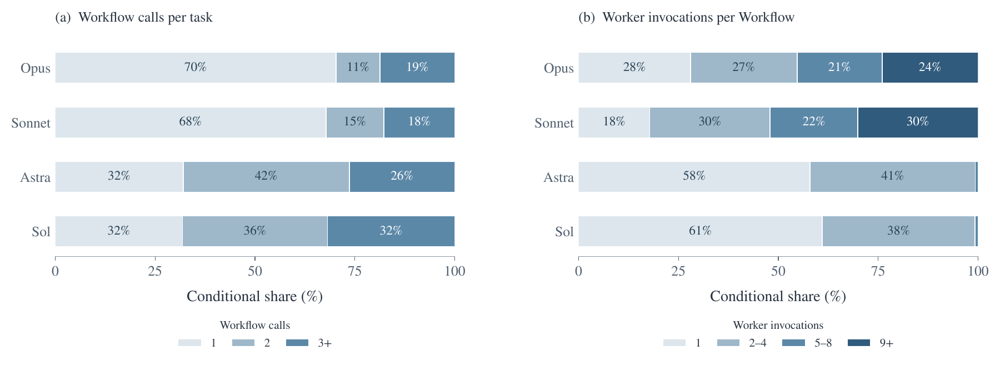

## Figure 7

Delegation across reasoning effort settings.

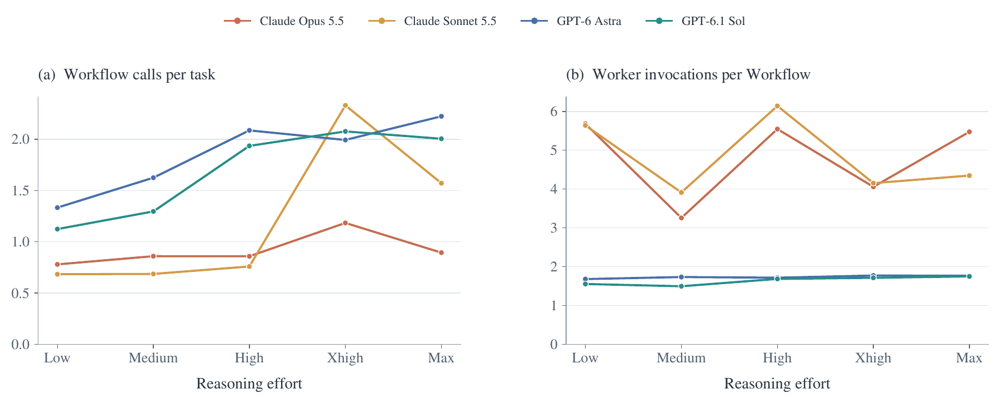

## Figure 8

Delegation across eight domains and nine models, at max effort except Doubao at high.

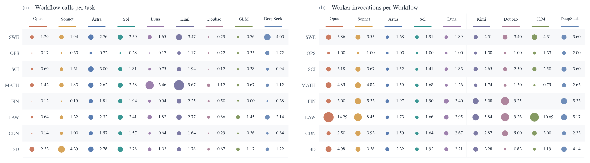

## Figure 9

Artifacts and workflows for three 3D construction tasks.

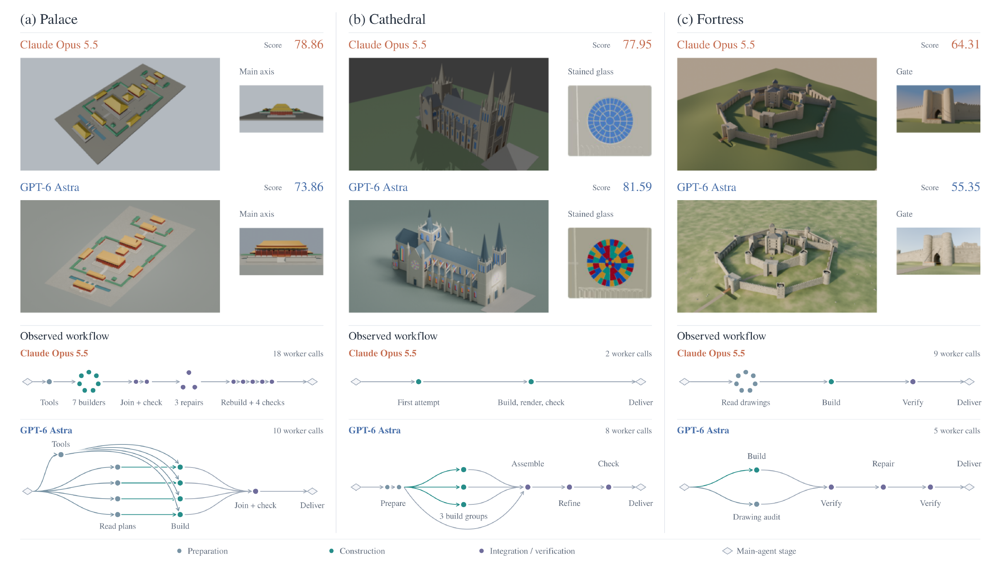

## Figure 10

Continuous score versus mean tokens per task.

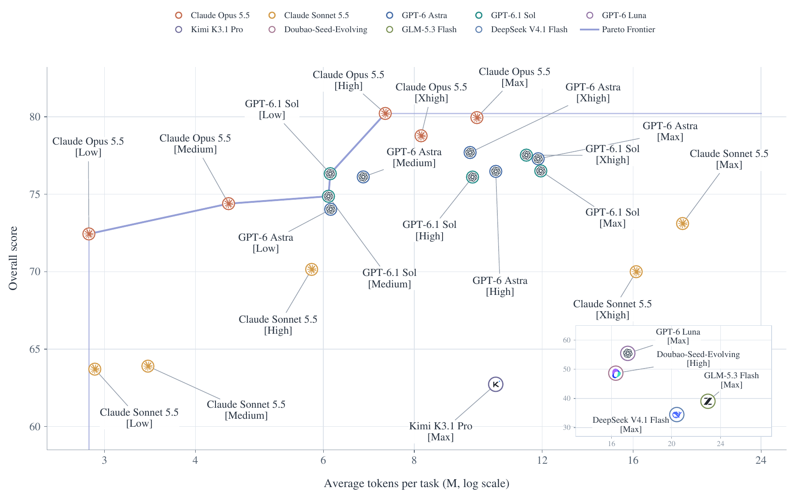

## Figure 11

Continuous score versus estimated mean inference cost per task.

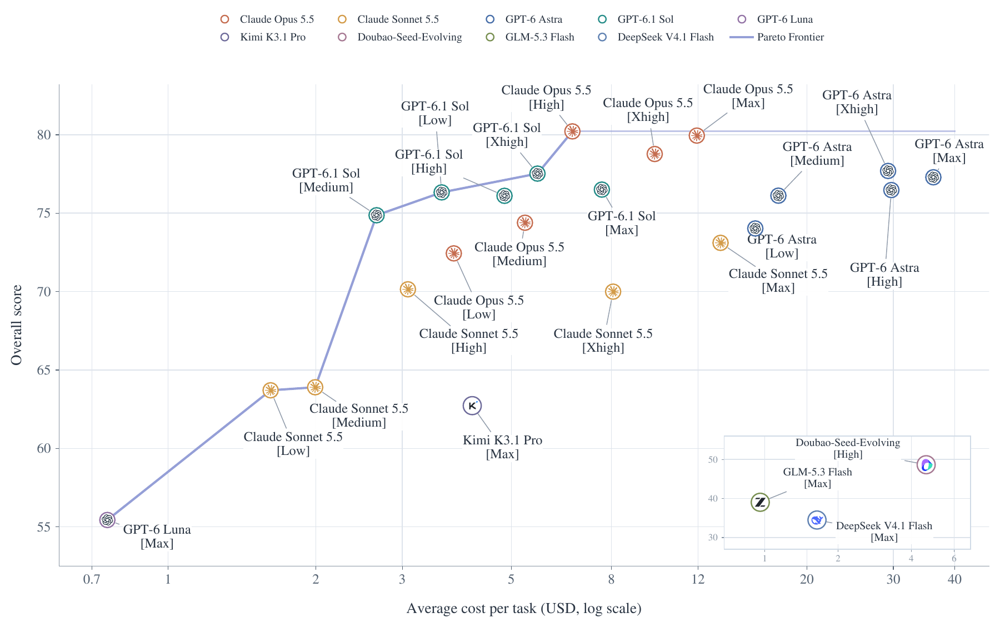
