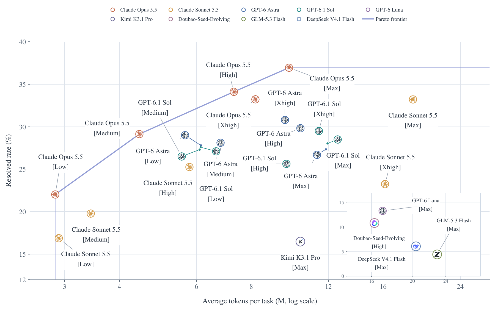
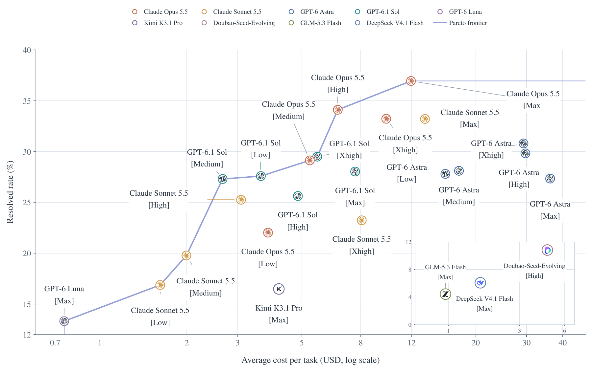
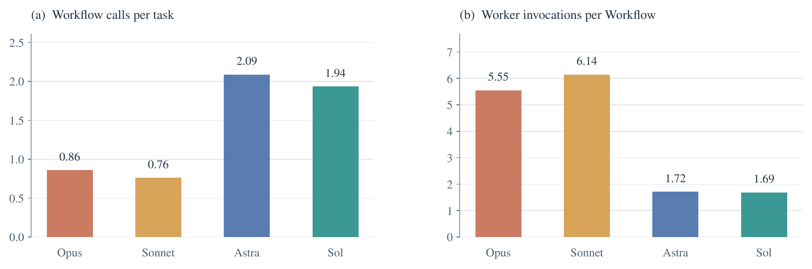
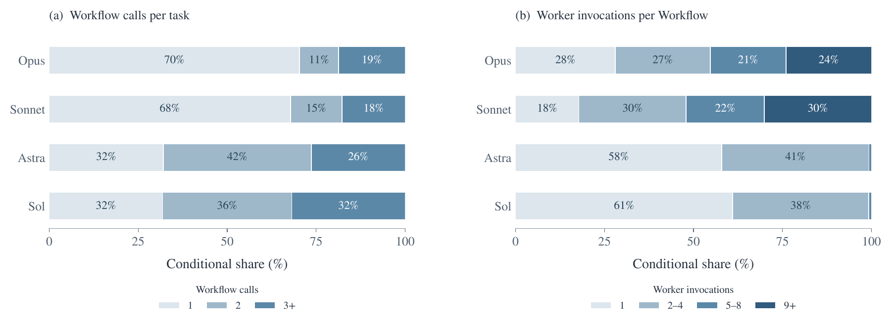
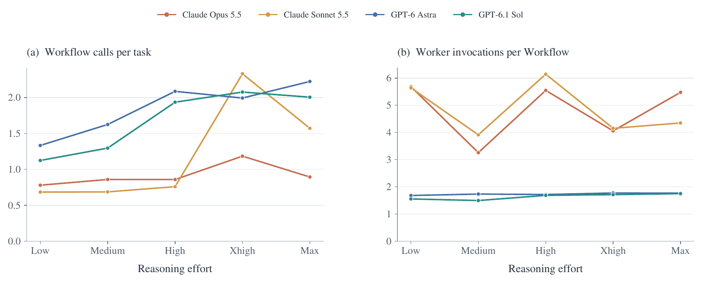
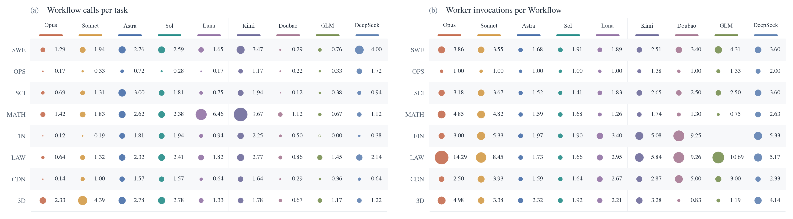
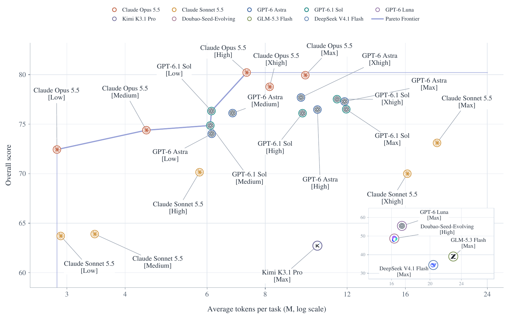
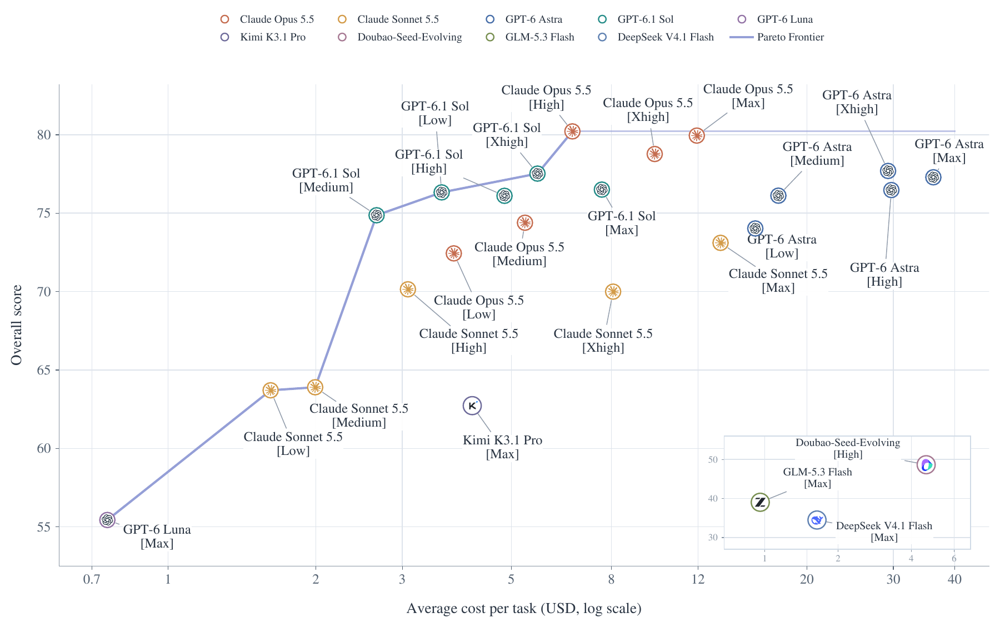

# Delegation and resource use

These are the figures as reported in the paper. Token totals include main-agent and worker usage. Cost figures use the paper's API price snapshot. Workflow calls per task include zero-call tasks unless the caption explicitly conditions on nonempty tasks; workers per Workflow uses launched Workflows as the denominator.

## Figure 3

Resolved rate versus mean tokens per task; input, output and cached input include main agents and workers.

## Figure 4

Resolved rate versus estimated mean inference cost per task, using the paper's pricing snapshot.

## Figure 5

Workflow invocation frequency and worker invocations per Workflow at high effort.

## Figure 6

Delegation frequency and size distributions, conditioned on nonempty tasks and Workflows.

## Figure 7

Delegation across reasoning effort settings.

## Figure 8

Delegation across eight domains and nine models, at max effort except Doubao at high.

## Figure 10

Continuous score versus mean tokens per task.

## Figure 11

Continuous score versus estimated mean inference cost per task.

